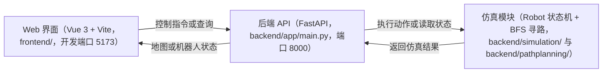

# 项目架构与接口

按实际实现补全下方架构图，或替换为自己的图。展示 Web 界面、后端 API 和仿真逻辑如何配合，以及控制指令和状态数据如何传递。

## 架构图

| 模块 | 实际职责 | 代码目录或入口 |
| --- | --- | --- |
| Web 界面 | 渲染地图/机器人/传感器面板，发送控制与巡检指令，巡检进行中每 500ms 轮询进度 | frontend/src/App.vue |
| 后端 API | 六端点契约、五错误码、巡检守卫与生命周期管理 | backend/app/main.py |
| 仿真逻辑 | 机器人运动/越界/碰撞判定、BFS 寻路、巡检调度 | backend/simulation/robot.py、backend/pathplanning/ |

## 数据约定

- 地图坐标原点、坐标方向和单位为 `原点 (0,0) 位于左上角，x 向右递增（0–15），y 向下递增（0–11），单位为格子`。
- 地图、边界和障碍物的表示方式为 `16×12 网格；GET /api/map 返回 width、height 与 obstacles 数组（[x, y] 格式，共 5 个障碍格）；边界即坐标范围 x∈[0,16)、y∈[0,12)，越界移动被拒绝`。
- 机器人位置、朝向和运行状态的字段含义为 `x、y 为格坐标整数；heading 为角度制朝向（90° 朝右/东，turn_right +90、turn_left −90）；status 取值 idle（正常）/ patrolling（巡检中）/ blocked（移动被拒后的受阻状态，下一次成功动作后恢复 idle）`。
- 前端获取最新状态的时机和方式为 `手动操作后即时 GET /api/robot；巡检进行中每 500ms 轮询 /api/patrol/progress；传感器面板每 500ms 轮询 /api/sensors/front；定时器在组件卸载与巡检结束时清理（PR #12/#17）`。

## 接口约定

填写项目实际使用的接口。按需补充自动巡检、路径规划和传感器接口。

| 用途 | 方法与路径 | 请求参数或请求体示例 | 成功响应示例 | 失败响应示例 |
| --- | --- | --- | --- | --- |
| 获取地图 | GET /api/map | 无 | `{"width":16,"height":12,"obstacles":[[5,3],[5,4],[6,4],[10,7],[11,7]]}`（实测） | 服务异常时 500 |
| 获取机器人状态 | GET /api/robot | 无 | `{"x":1,"y":1,"heading":90,"status":"idle"}`（实测） | 服务异常时 500 |
| 发送手动控制指令 | POST /api/robot/move | `{"action":"forward"}` | 200，返回更新后的机器人状态（同上字段） | 400 INVALID_ACTION；409 OUT_OF_BOUNDS / OBSTACLE_BLOCKED / PATROL_BLOCKED / PATROL_ALREADY_RUNNING（`{"error":{"code":"...","message":"中文提示"}}`） |
| 启动自动巡检 | POST /api/patrol/start | `{"points":[[4,8],[12,3],[14,10]]}` | 200，返回巡检任务信息（含进度字段） | 409 PATROL_ALREADY_RUNNING / TARGET_UNREACHABLE |
| 停止自动巡检 | POST /api/patrol/stop | 无 | 200，巡检终止、机器人回 idle | 服务异常时 500 |
| 查询巡检进度 | GET /api/patrol/progress | 无 | `{"active":true,"total":3,"current":0,"done":false}` | 服务异常时 500 |
| 前方障碍感知 | GET /api/sensors/front | 无 | 返回前方距离/障碍状态对象（字段以实际响应为准，随机器人位置变化） | 服务异常时 500 |

可执行的请求命令和预期结果填写在[后端 README](../backend/README.md)。
